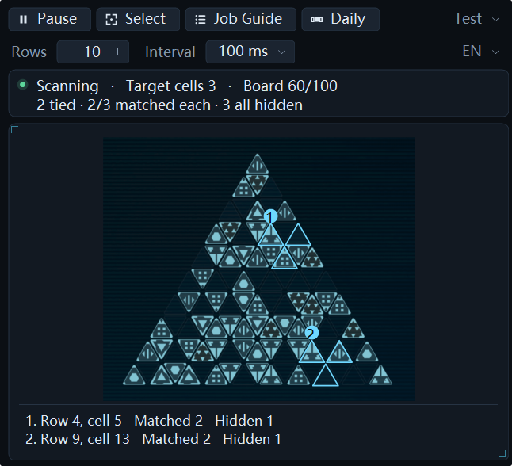
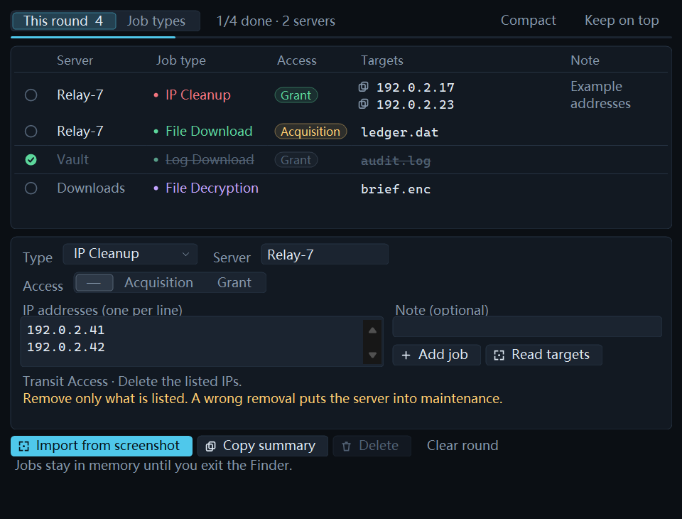
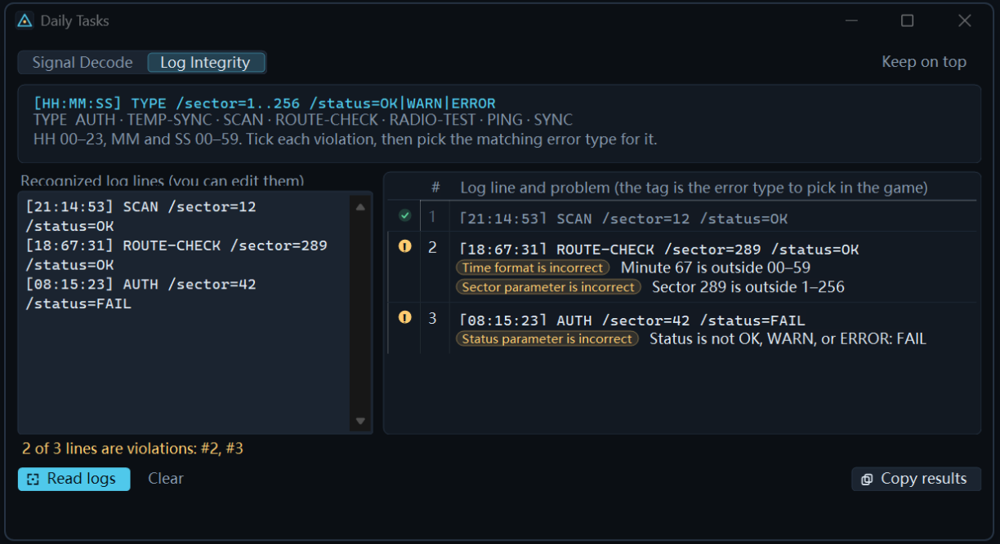
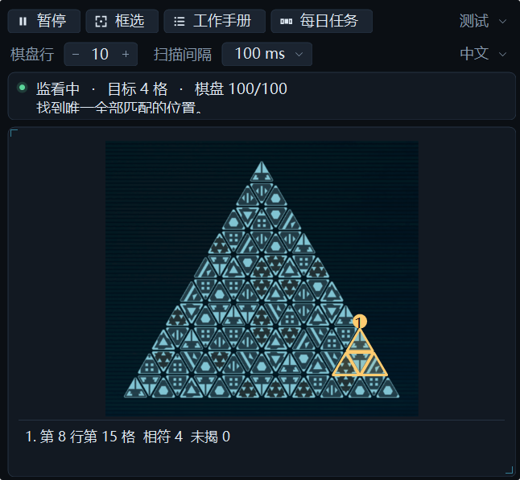
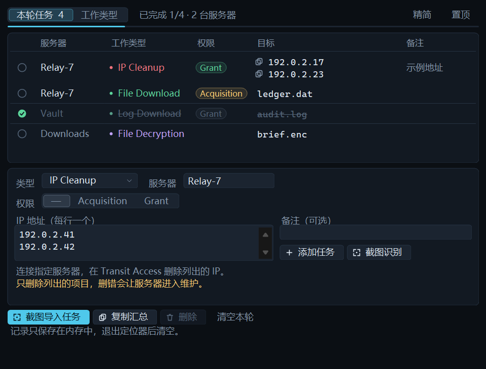
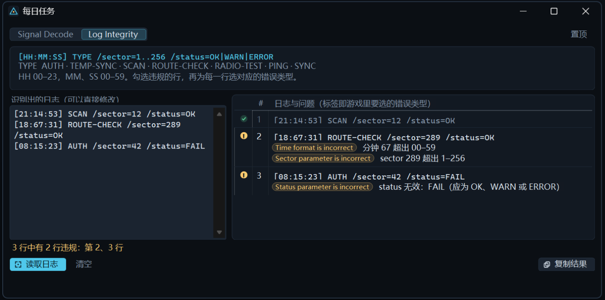

# ICE WALL BREAK Finder

**This project was built entirely by AI.**

[简体中文](#简体中文)

Tired of squinting at ICE WALL BREAK during your daily tasks on [cor3.gg](https://cor3.gg/)? Fed up with switching between the market and the target server to check job details? This Windows companion is for [cor3.gg](https://cor3.gg/). It starts in English. Choose **EN → 中文** to switch to Simplified Chinese.

## Quick start

1. Run `ICE-WALL-BREAK-Finder-v1.0.5.exe`.
2. In the File Decryption minigame, choose **Select**. Frame the target pattern area on the left, then the entire triangular board on the right.
3. Keep both areas visible. A yellow outline marks a unique full match. Blue outlines mark the current leading candidates.

## Features

- **ICE WALL BREAK** highlights candidate positions as tiles appear. The scan interval defaults to 100 ms.
- **Job Guide**. Choose **Import from screenshot** and frame one or more stacked, expanded job cards with their titles and both columns. The list reports added, duplicate, and incomplete cards. Job types are color-coded, with red for removals and green for downloads. You can also enter jobs manually, mark them done, and copy a summary grouped by server. The round is cleared when you exit.
- **Daily Tasks** reads all rows of a pulse signal and decodes Morse or Binary. Log Integrity checks each line and lists every detected error. You can review the recognized text before using it.

If the app reports a missing recognition language, go to **Settings → Time & language → Language & region** and add **English (United States)**.

## Screenshots

### Job Guide and Daily Tasks

Job Guide and Daily Tasks

## Build and test

Run `.\build.ps1` in PowerShell on Windows. The script runs the checks and puts `TriangleGlyphFinder.exe`, the simulator, and sample images in `build/`.

## Contributors

- **GPT-6.2 Sol** implemented and tested ICE WALL BREAK, refined Job Guide and Daily Tasks, and fixed UI display issues and most bugs.
- **Claude Opus 5.5** designed the interface and created the initial designs for Job Guide and Daily Tasks.

## 简体中文

**这个项目 100% 由 AI 制作。**

[English](#ice-wall-break-finder)

是否厌倦了在 [cor3.gg](https://cor3.gg/) 上每天清理日常任务时进行看瞎眼睛的 ICE WALL 破解？讨厌反复打开市场和目标服务器核对任务信息？这是 [cor3.gg](https://cor3.gg/) 的 Windows 辅助工具，首次启动默认使用英文。点 **EN → 中文** 即可切换。

### 快速开始

1. 运行 `ICE-WALL-BREAK-Finder-v1.0.5.exe`。
2. 进入文件解密小游戏，点 **框选**，先圈住左侧目标图形显示区，再圈住右侧整个三角棋盘。
3. 保持两块区域可见。黄框表示唯一的全匹配，蓝框表示当前领先的候选位置。

### 功能

- **ICE WALL BREAK** 随揭格进度自动更新候选位置，默认每 100 ms 扫描一次。
- **工作手册**。点 **截图导入任务**，一次框选一张或多张上下排列的展开任务卡，包含标题和左右两栏。导入后显示新增、重复及信息不全的数量。工作类型用颜色区分，删除和清理为红色，下载为绿色。也可手动添加、勾选完成并按服务器复制汇总，退出软件后清空本轮记录。
- **每日任务** 支持读取多行信号并解码 Morse 或 Binary，也能逐行检查日志并列出同一行的多个错误。截图识别的文字可在使用前核对。

如果软件提示缺少识别语言，到 **设置 → 时间和语言 → 语言和区域**添加 **英语（美国）**。

### 界面截图

#### 工作手册和每日任务

工作手册和每日任务

### 编译与测试

在 Windows PowerShell 运行 `.\build.ps1`。脚本会运行测试，并在 `build/` 生成 `TriangleGlyphFinder.exe`、模拟器和样图。

### 贡献者

- **GPT-6.2 Sol** 完成ICE WALL BREAK功能与测试，完善工作手册和日常任务功能。完成界面显示问题以及大部分Bug的修复。
- **Claude Opus 5.5** 完成界面设计，工作手册和日常任务功能的初步设计。
